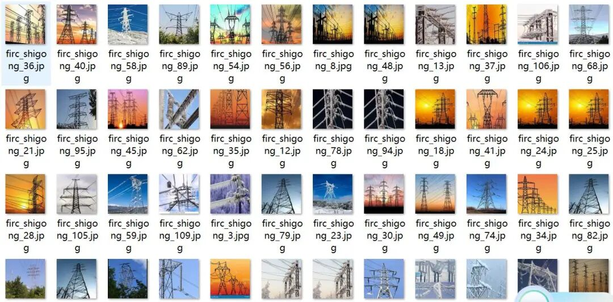
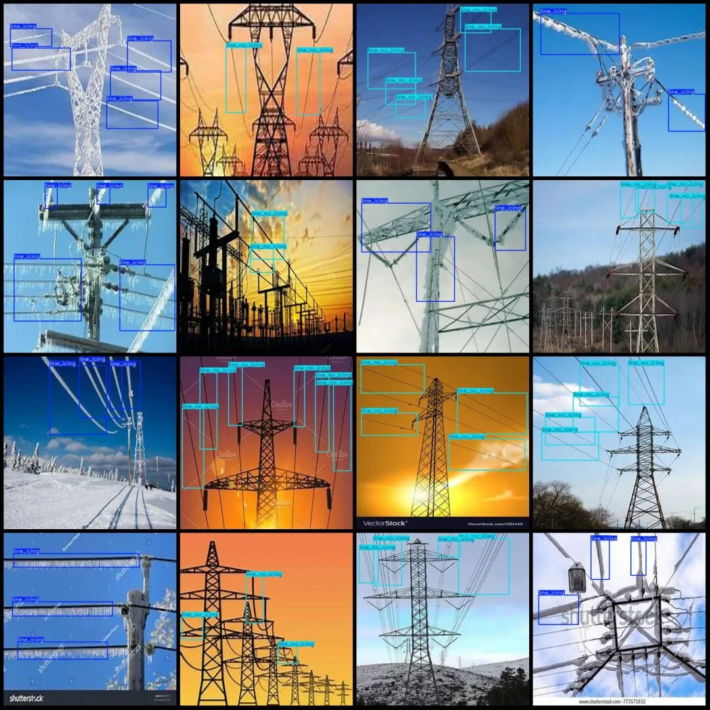

# Power Scene Transmission Line Ice Detection Dataset VOC+YOLO format with 109 images in 2 categories

Dataset format: Pascal VOC format + YOLO format (txt file without split path, only containing jpg images and corresponding VOC format xml files and yolo format txt files)

Number of images (number of jpg files): 109

Number of annotations (number of xml files): 109

Number of annotations (number of txt files): 109

Labeling category count: 2

Label category names (Note that the order of yolo format categories does not correspond to this, but is based on the labels folder's classes.txt): ["line_icing", "line_no_icing"]

Number of boxes labeled in each category:

Line Icing Frame Count = 175

Line_no_icing Frames = 213

Total frame count: 388

Image resolution: 640x640

Using labelImg:

Annotation rules: Draw a rectangle around the category.

Important Notice: No

Special : This dataset does not guarantee the accuracy of the trained models or weight files.

Image Preview:

Annotation example:

## Payment

Here is a pay link on Stripe ( https://buy.stripe.com/3cs8yP7sY87d0vu9AB ). Please contact me lonlonago@foxmail.com after funding $89, and I will send you a complete data files , thank you!

